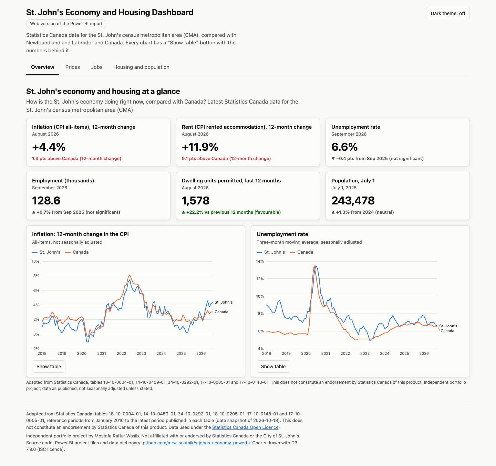
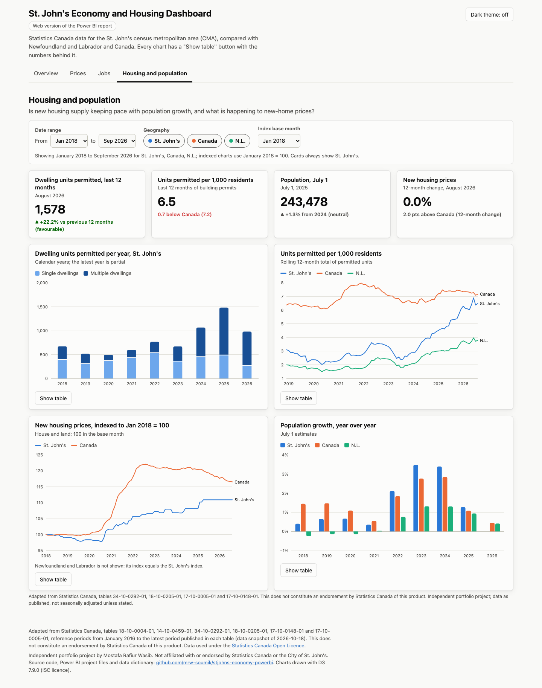
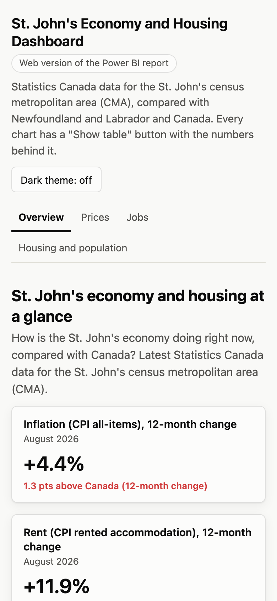

# St. John's Economy and Housing Dashboard (Power BI)

A Power BI dashboard on Statistics Canada open data for the St. John's census
metropolitan area (CMA): prices and shelter costs, jobs, housing supply and
population, compared with Newfoundland and Labrador and Canada. Every number
traces back to a Statistics Canada table and vector, and the pipeline that
prepares the data is tested.

> **View the live report:** link to be added after publishing (see the
> [publishing guide](docs/publish-guide.md)).
>
> **Web version:** the same four pages as a static site in `docs/`, to be served
> at https://mrw-soumik.github.io/stjohns-economy-powerbi/ once GitHub Pages is
> enabled.

Built by Mostafa Rafiur Wasib to put the "Power BI Essential Training"
certification into practice: Power Query, a star-schema semantic model, DAX
measures, an accessible report design, and the data engineering and testing
around them.



_Web version of the Power BI report (Overview page). Power BI Desktop screenshots
will be added once the project has been opened in Desktop._

## Why this dashboard

**Who it is for:** City of St. John's staff and councillors preparing briefings,
residents and journalists who want a sourced picture of the local economy, and
analysts who want to check a number against Statistics Canada.

**Business questions**

1. **Overview:** How is the St. John's economy doing right now, compared with
   Canada?
2. **Prices:** How fast are prices rising in St. John's compared with Canada,
   and which shelter costs are driving it?
3. **Jobs:** Is the St. John's labour market strengthening or weakening, and how
   does it compare with the province and Canada?
4. **Housing and population:** Is new housing supply keeping pace with
   population growth, and what is happening to new-home prices?

## Headline findings

<!-- findings:start -->
_Computed by `python -m stjohns_econ insights` from the data snapshot of 2026-10-18. Full sources, including vector IDs, are in [docs/findings.md](docs/findings.md)._

1. **Prices in St. John's are rising faster than in Canada over the past year, but have risen less since 2018.** St. John's all-items CPI rose 4.4% in the 12 months to August 2026, compared with 3.0% for Canada. Over the longer run the picture is reversed: from August 2018 to August 2026, prices rose 24.2% in St. John's and 26.5% nationally. _(Table 18-10-0004-01)_
2. **Shelter costs are rising much faster in St. John's than nationally.** In August 2026, St. John's shelter prices were 4.9% higher than a year earlier, against 1.5% for Canada. Within shelter, rented accommodation rose 11.9% (Canada 2.8%) and water, fuel and electricity 8.4% (Canada 4.9%), while owned accommodation rose 1.4% (Canada 0.5%). _(Table 18-10-0004-01)_
3. **A single year of rent increases moved St. John's ahead of Canada.** From August 2018 to August 2025, the rented accommodation index rose 30.2% in St. John's, less than Canada's 34.2%. One year of 11.9% growth (Canada 2.8%) reversed that: over the full period to August 2026, St. John's is up 45.6% against 37.9% for Canada. _(Table 18-10-0004-01)_
4. **The St. John's job market is stable, with unemployment close to the national rate.** The St. John's CMA unemployment rate was 6.6% in September 2026 (three-month moving average, seasonally adjusted), close to Canada's 6.5% and below the provincial 9.0%. The change from 7.0% a year earlier (−0.4 points) is within the 95% margin of error of 1.6 points (1.96 standard errors), so it is not statistically significant. Employment, at 128.6 thousand, is 12.5% above its 2019 average (Canada 11.1%). _(Table 14-10-0459-01)_
5. **Permitted housing supply is rising, led by multi-unit buildings.** Building permits in the St. John's CMA created 1,578 dwelling units in the 12 months to August 2026, 22.2% more than in the previous 12 months (Canada −2.0%). That is 6.5 units per 1,000 residents, below Canada's 7.2 (using the latest July 1 population estimates: 2025 for St. John's, 2026 for Canada). In 2025, 1,483 units were permitted, against 516 in 2019, and multiple-unit buildings (doubles, row houses and apartments) accounted for 67.5% of them, up from 41.1% in 2019. _(Tables 17-10-0005-01, 17-10-0148-01, 34-10-0292-01)_
6. **St. John's added 23,426 residents in four years, about 6.9 for every dwelling unit permitted.** The St. John's CMA population grew 10.6% from July 1, 2021 to July 1, 2025 (to 243,478, an increase of 23,426), faster than Canada (8.8%) and the province (4.4%). Over the same four years (July 2021 to June 2025), building permits created 3,392 dwelling units: one unit for every 6.9 new residents. Permits are not completions, and this ratio does not adjust for household size. _(Tables 17-10-0005-01, 17-10-0148-01, 34-10-0292-01)_
<!-- findings:end -->

## Data sources and licence

Six Statistics Canada tables, 61 vectors, loaded through the Statistics Canada
Web Data Service. Monthly data from January 2016 (two years before the 2018
focus period, so year-over-year measures are complete from 2018).

| Table | Content | Frequency | Used for |
|---|---|---|---|
| [18-10-0004-01](https://www150.statcan.gc.ca/t1/tbl1/en/tv.action?pid=1810000401) | Consumer Price Index, monthly, not seasonally adjusted | Monthly | All-items and shelter components (St. John's, N.L., Canada); food and energy (N.L., Canada) |
| [14-10-0459-01](https://www150.statcan.gc.ca/t1/tbl1/en/tv.action?pid=1410045901) | Labour force characteristics by CMA, three-month moving average, seasonally adjusted | Monthly | Unemployment, employment and participation rates, employment, standard errors |
| [34-10-0292-01](https://www150.statcan.gc.ca/t1/tbl1/en/tv.action?pid=3410029201) | Building permits, by type of structure and type of work | Monthly | Dwelling units created (total, single, multiple) |
| [18-10-0205-01](https://www150.statcan.gc.ca/t1/tbl1/en/tv.action?pid=1810020501) | New housing price index, monthly | Monthly | New-home prices (total, house only, land only) |
| [17-10-0148-01](https://www150.statcan.gc.ca/t1/tbl1/en/tv.action?pid=1710014801) | Population estimates, July 1, by CMA and census agglomeration, 2021 boundaries | Annual | St. John's CMA population |
| [17-10-0005-01](https://www150.statcan.gc.ca/t1/tbl1/en/tv.action?pid=1710000501) | Population estimates on July 1, by age and gender | Annual | N.L. and Canada population |

Every vector, coordinate, unit and reference period is listed in the
[data dictionary](docs/data-dictionary.md).

**Licence.** The data is used under the
[Statistics Canada Open Licence](https://www.statcan.gc.ca/en/terms-conditions/open-licence),
which requires these notices:

- For the data reproduced in `data/raw/` and `data/processed/`: "Source:
  Statistics Canada, name of product, reference date. Reproduced and distributed
  on an "as is" basis with the permission of Statistics Canada." (Products and
  reference dates: the tables above, January 2016 to the latest period in each
  table.)
- For the dashboard: "Adapted from Statistics Canada, name of product,
  reference date. This does not constitute an endorsement by Statistics Canada of
  this product."

The code is under the MIT licence ([LICENSE](LICENSE)). This is an independent
portfolio project, not affiliated with or endorsed by Statistics Canada or the
City of St. John's.

## Data model

<picture>
  <source media="(prefers-color-scheme: dark)" srcset="docs/model-diagram-dark.svg">
  
</picture>

One fact table holds every observation (date, geography, indicator, value);
`DimSeries` keeps the lineage to each Statistics Canada vector. Measures avoid
adding values with different units: they return blank unless one indicator and
one geography are in context, average stocks and rates, and sum flows. Details:
[powerbi/model.md](powerbi/model.md).

Measures cover the latest value, change from the previous period,
year-over-year change, 12-month rolling averages and totals, an index to any base
month, gaps to Canada, 95% confidence bounds and significance tests for Labour
Force Survey estimates, and units permitted per 1,000 residents.

## Repository layout

```
config/                 series catalogue: 61 vectors, indicators, geographies
src/stjohns_econ/       Python: ETL (fetch, build), findings, report spec and the generators
data/raw/statcan/       raw Web Data Service responses (snapshot) and fetch manifest
data/processed/         star schema as CSV (FactObservation, DimDate, DimGeography, DimIndicator, DimSeries)
powerbi/project/        Power BI Project: StJohnsEconomy.pbip, TMDL semantic model, PBIR report
powerbi/                Power Query (queries.pq), DAX (measures.dax), theme.json, model.md, VALIDATION.md
docs/                   web version (index.html, assets/, data/), data dictionary, report
                        specification, wireframes, findings, publishing guide, screenshots
tools/                  offline validators for PBIR JSON and TMDL
tests/                  data-quality, unit and consistency tests (pytest)
```

## How to open the report

- **Power BI Desktop (Windows):** open `powerbi/project/StJohnsEconomy.pbip`. The
  model, the 53 measures, the theme and all four pages are already defined; select
  Refresh and Desktop loads the data from this repository's CSV files on GitHub
  (anonymous access, privacy level Public). The check query at the end of
  `powerbi/measures.dax` should then match
  [powerbi/check-query-expected.csv](powerbi/check-query-expected.csv).
- **From a Mac, without Desktop:** connect a Microsoft Fabric workspace to this
  repository with Git integration, or deploy the project with Microsoft's
  `fabric-cicd` library. The [publishing guide](docs/publish-guide.md) gives the
  steps, the licence and capacity each route needs, and the "Publish to web"
  rules.
- **Web version:** open `docs/index.html` in any browser (no server needed), or
  use the GitHub Pages address above.

The project is generated from the files in `powerbi/` and the report
specification, so the text assets also support building the report by hand:
apply `theme.json`, paste each `queries.pq` section into a blank query, create the
relationships in [powerbi/model.md](powerbi/model.md), add the measures from
`measures.dax` through DAX query view, and lay out the pages from
[docs/report-spec.md](docs/report-spec.md).

**How it was checked:** every PBIR file validates against Microsoft's published
schemas (0 errors, 0 warnings), the TMDL model loads in Microsoft's Tabular
Object Model (0 errors, 0 warnings, stable round trip), and the DAX parses
without syntax errors. [powerbi/VALIDATION.md](powerbi/VALIDATION.md) lists the
tools, versions and commands, and what can only be confirmed in Power BI itself.

## Web version

`docs/index.html` is labelled "Web version of the Power BI report" and shows the
same pages, KPIs and charts from the same data, so the dashboard can be shared
publicly without a Power BI licence. Its numbers come from
`docs/assets/js/measures.js`, a mirror of the DAX measures that is tested against
the same expected results as the DAX check query.

- Every chart has a "Show table" button with the values behind it.
- Charts can be read with the keyboard (Tab to a chart, then the arrow keys); the
  values are announced to screen readers.
- Light and dark themes, each with its own validated colour steps.
- Checked in Chrome at 1440 and 390 pixels wide, in light and dark modes: no
  console errors, no horizontal scrolling, and no axe-core violations of the
  WCAG 2.1 A and AA rules.
- No third-party requests, cookies or tracking; D3 7.9.0 is included in the site.

| Desktop | Mobile |
|---|---|
|  |  |

More screenshots, including dark mode, are in [docs/screenshots](docs/screenshots).

## How to refresh the data

```bash
python3 -m venv .venv && source .venv/bin/activate
pip install -r requirements.txt
python -m stjohns_econ fetch      # about 6 polite requests to the Statistics Canada WDS
python -m stjohns_econ build      # validate and rebuild data/processed/*.csv
python -m pytest                  # data-quality and consistency tests
python -m stjohns_econ insights   # recompute the findings above
python -m stjohns_econ design     # regenerate the web data, wireframes and Power BI project
```

(`make refresh` runs the same steps.) Commit the updated files: Power BI picks up
the new CSVs on its next refresh, because the queries read from the GitHub raw
URLs, and GitHub Pages serves the updated web version.
Statistics Canada releases the CPI, the Labour Force Survey and building permits
monthly, so a monthly refresh after the CPI release keeps everything current.

## Data quality checks

`python -m pytest` runs about 100 tests, including:

- unique keys at every grain and referential integrity between fact and dimensions;
- no unexpected empty values, and only known Statistics Canada flags;
- expected date coverage for every series, no gaps, and data that is current at
  the snapshot date;
- one unit per indicator, matching the unit Statistics Canada reports, and
  plausible value ranges;
- single plus multiple dwelling units add up to the total in every month;
- Power Query column types match the CSVs; every DAX column, measure and code
  reference exists; the theme uses the validated palette;
- the README findings, data dictionary tables and wireframes match the data and
  the specification;
- the Power BI Project is current, validates against Microsoft's PBIR schemas,
  and its measures, folders and formats match `measures.dax` and `model.md`;
- the web version's measures give the same results as the DAX reference.

## Limitations

- St. John's CPI covers all-items and shelter components only; Statistics Canada
  does not publish food or energy indexes for the city.
- Labour Force Survey estimates for a CMA have sampling error; the report flags
  changes that are within 1.96 standard errors.
- Building permits show permitted supply, not completions, and are revised after
  first release.
- The latest St. John's population estimate is for July 1, 2025, one year behind
  the provincial and national estimates.
- The New Housing Price Index land component is flagged "use with caution" by
  Statistics Canada for every month.
- Figures are as published on the snapshot date (October 18, 2026, UTC) and will
  change with Statistics Canada revisions.
- The Power BI Project was built and validated on a Mac. It passes Microsoft's
  schemas and loads in Microsoft's model library, but it has not yet been opened
  in Power BI Desktop; [powerbi/VALIDATION.md](powerbi/VALIDATION.md) lists what
  to confirm there.
