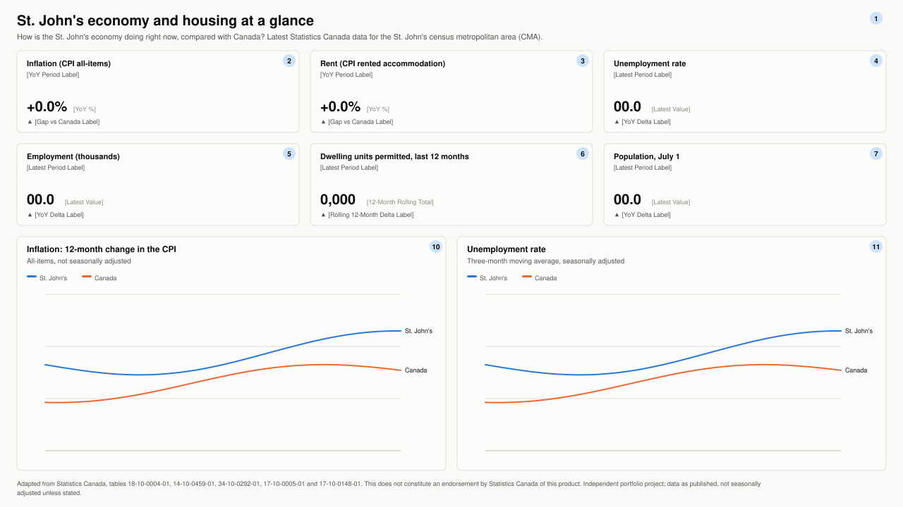
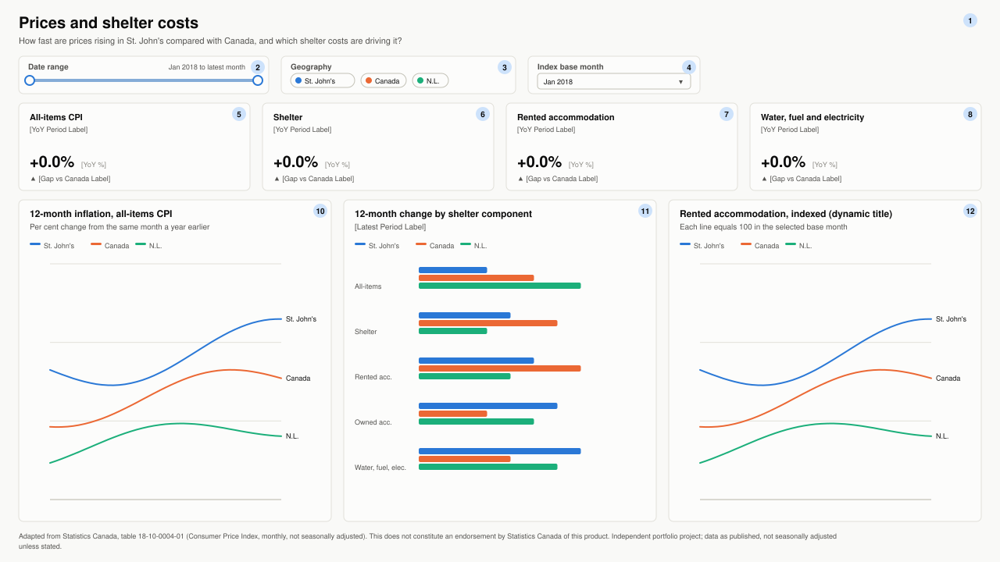
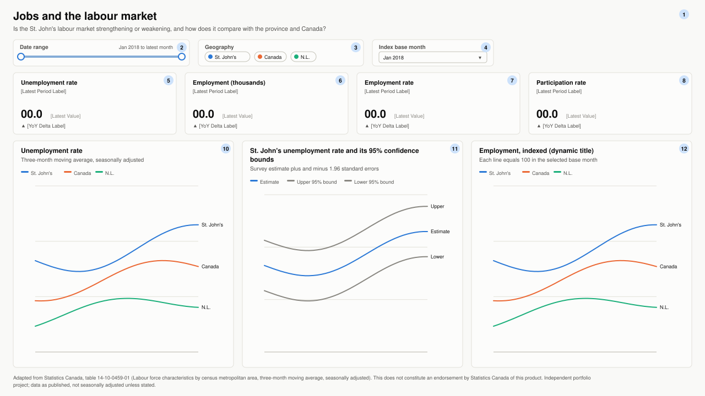
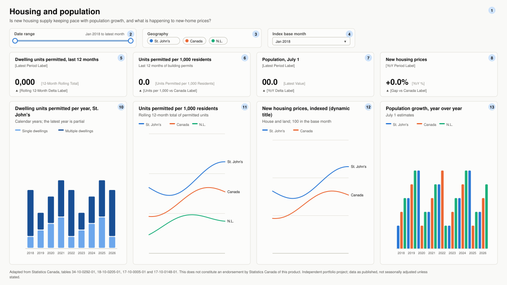

# Report specification

The St. John's Economy and Housing Dashboard has four pages. This document is the
blueprint for both the Power BI report (`powerbi/StJohnsEconomy.Report`, PBIR
format) and its web version (`docs/index.html`). The tables of visuals below are
generated from `src/stjohns_econ/report_spec.py`, the same definition the report
and the web version are built from, so the three never disagree.

**Audience.** People who need a quick, sourced picture of the St. John's economy:
City of St. John's staff and councillors preparing briefings, residents and
journalists, and analysts who want to check a number against Statistics Canada.

**Measures** are defined in [powerbi/measures.dax](../powerbi/measures.dax) and
listed in [powerbi/model.md](../powerbi/model.md). Field references below use
`Table[Column]` for columns and `[Measure]` for measures.

## Design principles

The charts follow a documented data-visualisation method (form first, colour
last, colours validated by script rather than by eye):

1. **Form follows the question.** KPI cards for the headline numbers, lines for
   trends, bars for a comparison at one point in time, stacked columns for
   part-to-whole.
2. **One axis per chart.** When scales differ, values are indexed to a base month
   (`[Index (Base = 100)]`) or put on a per-resident basis
   (`[Units Permitted per 1,000 Residents]`). No dual-axis charts.
3. **Colour follows the geography, never its rank.** St. John's `#2a78d6`,
   Canada `#eb6834`, Newfoundland and Labrador `#1baf7a` on every page. Series
   colours are set explicitly, so a filter never repaints a series. The three
   colours are the first slots of a palette validated for colour-vision
   deficiency (all pairs) in light and dark modes.
4. **Identity is never colour alone.** Every chart with two or more series has a
   legend and a label at the end of each line. Labels and values use ink colours
   (`#0b0b0b`, `#52514e`), not the series colour.
5. **Quiet marks.** 2 px lines, solid hairline gridlines, bars no thicker than
   24 px, a 2 px surface-coloured gap between stacked segments.
6. **Judgement words come with colour, not instead of it.** KPI changes show an
   icon (▲ ▼ ■), a signed number, the comparison period and a word
   (favourable, unfavourable, neutral, not significant); the green `#006300` and
   red `#d03b3b` only reinforce them.
7. **Every chart has a table.** "Show as a table" (Alt+Shift+F11) in Power BI;
   a "Show table" button under each chart in the web version.

## Layout and navigation

- Page size 1280 x 720 (16:9), 24 px margins, 16 px gutters.
- Top to bottom: page title with the business question, one row of slicers,
  a row of KPI cards, the charts, then the source and licence notice.
- Slicers: **Date range** (`DimDate[Date]`, between), **Geography**
  (`DimGeography[ShortName]`, multi-select tiles) and **Index base month**
  (`BasePeriod[BaseLabel]`, single-select dropdown). The three detail pages have
  a page-level filter `DimDate[Date] >= 2018-01-01`, so the date range starts in
  January 2018; measures that look back a year still see 2016 and 2017 because
  they clear date filters internally.
- KPI cards always describe St. John's. They carry visual-level filters for
  their indicator and for `GeographyCode = SJ`, and they ignore the geography
  slicer (Format > Edit interactions > None).
- The Power BI page tabs (and the page buttons in the web version) move between
  pages in this order: Overview, Prices, Jobs, Housing and population.

## Page 1: Overview

**Business question:** How is the St. John's economy doing right now, compared
with Canada?

**Decisions supported:** whether a briefing should lead with prices, jobs or
housing; which indicators need a closer look on the detail pages.

<!-- page-overview:start -->
Page-level filters: none. No slicers. Cards are fixed to St. John's by visual-level filters; the two charts compare St. John's with Canada from January 2018.
<!-- page-overview:end -->

<!-- visuals-overview:start -->
| Tab | ID | Visual | Title | Fields and measures | Visual filters | Position (x, y, w x h) | Alt text |
|---|---|---|---|---|---|---|---|
| 1 | `overview_title` | Text box | St. John's economy and housing at a glance | Static text | none | 24, 12, 1232 x 52 | Page title: St. John's economy and housing at a glance. How is the St. John's economy doing right now, compared with Canada? Latest Statistics Canada data for the St. John's census metropolitan area (CMA). |
| 2 | `ov_kpi_inflation` | KPI card | Inflation (CPI all-items) | Value: [YoY %]; Delta: [Gap vs Canada Label]; Delta colour (fx): [Gap Colour]; Subtitle (fx): [YoY Period Label] | DimIndicator[IndicatorCode] is CPI_ALL; DimGeography[GeographyCode] is SJ | 24, 72, 400 x 116 | St. John's 12-month change in the all-items Consumer Price Index, with the gap to Canada in percentage points. |
| 3 | `ov_kpi_rent` | KPI card | Rent (CPI rented accommodation) | Value: [YoY %]; Delta: [Gap vs Canada Label]; Delta colour (fx): [Gap Colour]; Subtitle (fx): [YoY Period Label] | DimIndicator[IndicatorCode] is CPI_RENTED; DimGeography[GeographyCode] is SJ | 440, 72, 400 x 116 | St. John's 12-month change in the rented accommodation index, with the gap to Canada. |
| 4 | `ov_kpi_unemployment` | KPI card | Unemployment rate | Value: [Latest Value]; Delta: [YoY Delta Label]; Delta colour (fx): [YoY Delta Colour]; Subtitle (fx): [Latest Period Label] | DimIndicator[IndicatorCode] is LFS_UR; DimGeography[GeographyCode] is SJ | 856, 72, 400 x 116 | St. John's unemployment rate, three-month moving average, with the change from a year earlier and whether it is statistically significant. |
| 5 | `ov_kpi_employment` | KPI card | Employment (thousands) | Value: [Latest Value]; Delta: [YoY Delta Label]; Delta colour (fx): [YoY Delta Colour]; Subtitle (fx): [Latest Period Label] | DimIndicator[IndicatorCode] is LFS_EMP; DimGeography[GeographyCode] is SJ | 24, 204, 400 x 116 | Employed people in the St. John's CMA, in thousands, with the 12-month change and its significance. |
| 6 | `ov_kpi_permits` | KPI card | Dwelling units permitted, last 12 months | Value: [12-Month Rolling Total]; Delta: [Rolling 12-Month Delta Label]; Delta colour (fx): [Rolling 12-Month Delta Colour]; Subtitle (fx): [Latest Period Label] | DimIndicator[IndicatorCode] is BP_UNITS; DimGeography[GeographyCode] is SJ | 440, 204, 400 x 116 | Dwelling units created by building permits in the St. John's CMA over the last 12 months, compared with the 12 months before. |
| 7 | `ov_kpi_population` | KPI card | Population, July 1 | Value: [Latest Value]; Delta: [YoY Delta Label]; Delta colour (fx): [YoY Delta Colour]; Subtitle (fx): [Latest Period Label] | DimIndicator[IndicatorCode] is POP; DimGeography[GeographyCode] is SJ | 856, 204, 400 x 116 | St. John's CMA population on July 1 of the latest year, with growth from the year before. |
| 10 | `ov_chart_inflation` | Line chart | Inflation: 12-month change in the CPI | X axis: DimDate[MonthStart]; Y axis: [YoY %]; Legend: DimGeography[ShortName]; Tooltips: [YoY Gap vs Canada (pts)] | DimIndicator[IndicatorCode] is CPI_ALL; DimGeography[GeographyCode] in (SJ, CA); DimDate[Date] >= 2018-01-01 | 24, 336, 608 x 332 | Line chart of 12-month CPI inflation since January 2018 for St. John's and Canada. Use Show as a table (Alt+Shift+F11) to read the values. |
| 11 | `ov_chart_unemployment` | Line chart | Unemployment rate | X axis: DimDate[MonthStart]; Y axis: [Latest Value]; Legend: DimGeography[ShortName]; Tooltips: [Gap vs Canada] | DimIndicator[IndicatorCode] is LFS_UR; DimGeography[GeographyCode] in (SJ, CA); DimDate[Date] >= 2018-01-01 | 648, 336, 608 x 332 | Line chart of the unemployment rate since January 2018 for St. John's and Canada. Use Show as a table (Alt+Shift+F11) to read the values. |
| 99 | `overview_footer` | Text box | Source and licence notice | Static text | none | 24, 676, 1232 x 36 | Source and licence notice. |
<!-- visuals-overview:end -->

## Page 2: Prices

**Business question:** How fast are prices rising in St. John's compared with
Canada, and which shelter costs are driving it?

**Decisions supported:** whether cost-of-living pressure in St. John's is broad
or concentrated in shelter, and how rent and household energy compare with the
national trend.

<!-- page-prices:start -->
Page-level filters: DimDate[Date] >= 2018-01-01. Date and geography slicers filter the three charts; the four cards show St. John's only and ignore the geography slicer. The base-month slicer only changes the indexed chart.
<!-- page-prices:end -->

<!-- visuals-prices:start -->
| Tab | ID | Visual | Title | Fields and measures | Visual filters | Position (x, y, w x h) | Alt text |
|---|---|---|---|---|---|---|---|
| 1 | `prices_title` | Text box | Prices and shelter costs | Static text | none | 24, 12, 1232 x 52 | Page title: Prices and shelter costs. How fast are prices rising in St. John's compared with Canada, and which shelter costs are driving it? |
| 2 | `prices_slicer_date` | Slicer, between (date range) | Date range | Field: DimDate[Date] | none | 24, 72, 320 x 48 | Date range slicer. Sets the period shown in every chart on this page; cards show the latest month in the range. |
| 3 | `prices_slicer_geography` | Slicer, tiles (multi-select) | Geography | Field: DimGeography[ShortName] | none | 360, 72, 300 x 48 | Geography slicer. Chooses which of St. John's, the province and Canada appear in the comparison charts. |
| 4 | `prices_slicer_base` | Slicer, dropdown (single select) | Index base month | Field: BasePeriod[BaseLabel] | none | 676, 72, 220 x 48 | Base month for indexed charts. Indexed lines equal 100 in this month. |
| 5 | `pr_kpi_all` | KPI card | All-items CPI | Value: [YoY %]; Delta: [Gap vs Canada Label]; Delta colour (fx): [Gap Colour]; Subtitle (fx): [YoY Period Label] | DimIndicator[IndicatorCode] is CPI_ALL; DimGeography[GeographyCode] is SJ | 24, 132, 296 x 112 | St. John's 12-month change in the All-items CPI index, with the gap to Canada in percentage points. |
| 6 | `pr_kpi_shelter` | KPI card | Shelter | Value: [YoY %]; Delta: [Gap vs Canada Label]; Delta colour (fx): [Gap Colour]; Subtitle (fx): [YoY Period Label] | DimIndicator[IndicatorCode] is CPI_SHELTER; DimGeography[GeographyCode] is SJ | 336, 132, 296 x 112 | St. John's 12-month change in the Shelter index, with the gap to Canada in percentage points. |
| 7 | `pr_kpi_rent` | KPI card | Rented accommodation | Value: [YoY %]; Delta: [Gap vs Canada Label]; Delta colour (fx): [Gap Colour]; Subtitle (fx): [YoY Period Label] | DimIndicator[IndicatorCode] is CPI_RENTED; DimGeography[GeographyCode] is SJ | 648, 132, 296 x 112 | St. John's 12-month change in the Rented accommodation index, with the gap to Canada in percentage points. |
| 8 | `pr_kpi_wfe` | KPI card | Water, fuel and electricity | Value: [YoY %]; Delta: [Gap vs Canada Label]; Delta colour (fx): [Gap Colour]; Subtitle (fx): [YoY Period Label] | DimIndicator[IndicatorCode] is CPI_WFE; DimGeography[GeographyCode] is SJ | 960, 132, 296 x 112 | St. John's 12-month change in the Water, fuel and electricity index, with the gap to Canada in percentage points. |
| 10 | `pr_chart_inflation` | Line chart | 12-month inflation, all-items CPI | X axis: DimDate[MonthStart]; Y axis: [YoY %]; Legend: DimGeography[ShortName]; Tooltips: [YoY Gap vs Canada (pts)] | DimIndicator[IndicatorCode] is CPI_ALL | 24, 256, 400 x 412 | Line chart of 12-month all-items CPI inflation for the selected geographies and dates. Use Show as a table (Alt+Shift+F11) to read the values. |
| 11 | `pr_chart_components` | Clustered bar chart | 12-month change by shelter component | X axis: DimIndicator[ShortName]; Y axis: [YoY %]; Legend: DimGeography[ShortName]; Subtitle (fx): [Latest Period Label] | DimIndicator[IndicatorCode] in (CPI_ALL, CPI_SHELTER, CPI_RENTED, CPI_OWNED, CPI_WFE) | 440, 256, 400 x 412 | Bar chart comparing the latest 12-month change in all-items CPI and each shelter component across the selected geographies. |
| 12 | `pr_chart_rent_index` | Line chart | Rented accommodation, indexed | X axis: DimDate[MonthStart]; Y axis: [Index (Base = 100)]; Legend: DimGeography[ShortName]; Tooltips: [Change Since Base %], [Index Gap vs Canada]; Title (fx): [Index Chart Title] | DimIndicator[IndicatorCode] is CPI_RENTED | 856, 256, 400 x 412 | Line chart of the rented accommodation price index rebased to 100 in the selected base month, by geography. |
| 99 | `prices_footer` | Text box | Source and licence notice | Static text | none | 24, 676, 1232 x 36 | Source and licence notice. |
<!-- visuals-prices:end -->

Notes: the clustered bar chart shows the latest month inside the date range for
each component. Statistics Canada does not publish food or energy indexes for
St. John's, so those components are not shown on this page (they are in the
model for Canada and the province).

## Page 3: Jobs

**Business question:** Is the St. John's labour market strengthening or
weakening, and how does it compare with the province and Canada?

**Decisions supported:** whether a change in the unemployment rate is real or
within sampling error before it is quoted; how employment growth compares since
a chosen base month.

<!-- page-jobs:start -->
Page-level filters: DimDate[Date] >= 2018-01-01. Date and geography slicers filter the comparison charts; the cards and the confidence-bounds chart show St. John's only and ignore the geography slicer.
<!-- page-jobs:end -->

<!-- visuals-jobs:start -->
| Tab | ID | Visual | Title | Fields and measures | Visual filters | Position (x, y, w x h) | Alt text |
|---|---|---|---|---|---|---|---|
| 1 | `jobs_title` | Text box | Jobs and the labour market | Static text | none | 24, 12, 1232 x 52 | Page title: Jobs and the labour market. Is the St. John's labour market strengthening or weakening, and how does it compare with the province and Canada? |
| 2 | `jobs_slicer_date` | Slicer, between (date range) | Date range | Field: DimDate[Date] | none | 24, 72, 320 x 48 | Date range slicer. Sets the period shown in every chart on this page; cards show the latest month in the range. |
| 3 | `jobs_slicer_geography` | Slicer, tiles (multi-select) | Geography | Field: DimGeography[ShortName] | none | 360, 72, 300 x 48 | Geography slicer. Chooses which of St. John's, the province and Canada appear in the comparison charts. |
| 4 | `jobs_slicer_base` | Slicer, dropdown (single select) | Index base month | Field: BasePeriod[BaseLabel] | none | 676, 72, 220 x 48 | Base month for indexed charts. Indexed lines equal 100 in this month. |
| 5 | `jb_kpi_unemployment` | KPI card | Unemployment rate | Value: [Latest Value]; Delta: [YoY Delta Label]; Delta colour (fx): [YoY Delta Colour]; Subtitle (fx): [Latest Period Label] | DimIndicator[IndicatorCode] is LFS_UR; DimGeography[GeographyCode] is SJ | 24, 132, 296 x 112 | St. John's unemployment rate, three-month moving average, with the 12-month change and whether it is statistically significant. |
| 6 | `jb_kpi_employment` | KPI card | Employment (thousands) | Value: [Latest Value]; Delta: [YoY Delta Label]; Delta colour (fx): [YoY Delta Colour]; Subtitle (fx): [Latest Period Label] | DimIndicator[IndicatorCode] is LFS_EMP; DimGeography[GeographyCode] is SJ | 336, 132, 296 x 112 | St. John's employment (thousands), three-month moving average, with the 12-month change and whether it is statistically significant. |
| 7 | `jb_kpi_employment_rate` | KPI card | Employment rate | Value: [Latest Value]; Delta: [YoY Delta Label]; Delta colour (fx): [YoY Delta Colour]; Subtitle (fx): [Latest Period Label] | DimIndicator[IndicatorCode] is LFS_ER; DimGeography[GeographyCode] is SJ | 648, 132, 296 x 112 | St. John's employment rate, three-month moving average, with the 12-month change and whether it is statistically significant. |
| 8 | `jb_kpi_participation` | KPI card | Participation rate | Value: [Latest Value]; Delta: [YoY Delta Label]; Delta colour (fx): [YoY Delta Colour]; Subtitle (fx): [Latest Period Label] | DimIndicator[IndicatorCode] is LFS_PR; DimGeography[GeographyCode] is SJ | 960, 132, 296 x 112 | St. John's participation rate, three-month moving average, with the 12-month change and whether it is statistically significant. |
| 10 | `jb_chart_unemployment` | Line chart | Unemployment rate | X axis: DimDate[MonthStart]; Y axis: [Latest Value]; Legend: DimGeography[ShortName]; Tooltips: [YoY Change], [YoY Significance Label] | DimIndicator[IndicatorCode] is LFS_UR | 24, 256, 400 x 412 | Line chart of the unemployment rate for the selected geographies and dates. Use Show as a table (Alt+Shift+F11) to read the values. |
| 11 | `jb_chart_uncertainty` | Line chart | St. John's unemployment rate and its 95% confidence bounds | X axis: DimDate[MonthStart]; Y axis: [Latest Value], [Upper 95% Bound], [Lower 95% Bound] | DimIndicator[IndicatorCode] is LFS_UR; DimGeography[GeographyCode] is SJ (ignores the geography slicer) | 440, 256, 400 x 412 | Line chart of the St. John's unemployment rate with upper and lower 95% confidence bounds, showing the survey's sampling uncertainty. |
| 12 | `jb_chart_employment_index` | Line chart | Employment, indexed | X axis: DimDate[MonthStart]; Y axis: [Index (Base = 100)]; Legend: DimGeography[ShortName]; Tooltips: [Change Since Base %]; Title (fx): [Index Chart Title] | DimIndicator[IndicatorCode] is LFS_EMP | 856, 256, 400 x 412 | Line chart of employment rebased to 100 in the selected base month, comparing growth across geographies. |
| 99 | `jobs_footer` | Text box | Source and licence notice | Static text | none | 24, 676, 1232 x 36 | Source and licence notice. |
<!-- visuals-jobs:end -->

Notes: Labour Force Survey estimates for a census metropolitan area are
three-month moving averages with published standard errors. The KPI delta labels
say "not significant" when the 12-month change is within 1.96 standard errors.
The confidence-bounds chart uses grey (`#898781`) for the bounds and the
St. John's blue for the estimate; its legend names all three lines.

## Page 4: Housing and population

**Business question:** Is new housing supply keeping pace with population
growth, and what is happening to new-home prices?

**Decisions supported:** whether permitted housing supply per resident is above
or below the national pace; how the mix of single and multiple dwellings is
changing; how new-home prices compare with Canada.

<!-- page-housing:start -->
Page-level filters: DimDate[Date] >= 2018-01-01. Date and geography slicers filter the comparison charts; the cards and the stacked column chart show St. John's only and ignore the geography slicer.
<!-- page-housing:end -->

<!-- visuals-housing:start -->
| Tab | ID | Visual | Title | Fields and measures | Visual filters | Position (x, y, w x h) | Alt text |
|---|---|---|---|---|---|---|---|
| 1 | `housing_title` | Text box | Housing and population | Static text | none | 24, 12, 1232 x 52 | Page title: Housing and population. Is new housing supply keeping pace with population growth, and what is happening to new-home prices? |
| 2 | `housing_slicer_date` | Slicer, between (date range) | Date range | Field: DimDate[Date] | none | 24, 72, 320 x 48 | Date range slicer. Sets the period shown in every chart on this page; cards show the latest month in the range. |
| 3 | `housing_slicer_geography` | Slicer, tiles (multi-select) | Geography | Field: DimGeography[ShortName] | none | 360, 72, 300 x 48 | Geography slicer. Chooses which of St. John's, the province and Canada appear in the comparison charts. |
| 4 | `housing_slicer_base` | Slicer, dropdown (single select) | Index base month | Field: BasePeriod[BaseLabel] | none | 676, 72, 220 x 48 | Base month for indexed charts. Indexed lines equal 100 in this month. |
| 5 | `hs_kpi_permits` | KPI card | Dwelling units permitted, last 12 months | Value: [12-Month Rolling Total]; Delta: [Rolling 12-Month Delta Label]; Delta colour (fx): [Rolling 12-Month Delta Colour]; Subtitle (fx): [Latest Period Label] | DimIndicator[IndicatorCode] is BP_UNITS; DimGeography[GeographyCode] is SJ | 24, 132, 296 x 112 | Dwelling units created by building permits in the St. John's CMA over the last 12 months, compared with the 12 months before. |
| 6 | `hs_kpi_per_capita` | KPI card | Units permitted per 1,000 residents | Value: [Units Permitted per 1,000 Residents]; Delta: [Units per 1,000 vs Canada Label]; Delta colour (fx): [Units per 1,000 vs Canada Colour] | DimGeography[GeographyCode] is SJ | 336, 132, 296 x 112 | Dwelling units permitted in the last 12 months per 1,000 St. John's residents, compared with Canada. |
| 7 | `hs_kpi_population` | KPI card | Population, July 1 | Value: [Latest Value]; Delta: [YoY Delta Label]; Delta colour (fx): [YoY Delta Colour]; Subtitle (fx): [Latest Period Label] | DimIndicator[IndicatorCode] is POP; DimGeography[GeographyCode] is SJ | 648, 132, 296 x 112 | St. John's CMA population on July 1 of the latest year, with growth from the year before. |
| 8 | `hs_kpi_new_home_prices` | KPI card | New housing prices | Value: [YoY %]; Delta: [Gap vs Canada Label]; Delta colour (fx): [Gap Colour]; Subtitle (fx): [YoY Period Label] | DimIndicator[IndicatorCode] is NHPI_TOTAL; DimGeography[GeographyCode] is SJ | 960, 132, 296 x 112 | St. John's 12-month change in the New Housing Price Index, with the gap to Canada. |
| 10 | `hs_chart_permits_by_type` | Stacked column chart | Dwelling units permitted per year, St. John's | X axis: DimDate[Year]; Y axis: [Value]; Legend: DimIndicator[ShortName]; Tooltips: [Multi-unit Share %] | DimIndicator[IndicatorCode] in (BP_UNITS_SINGLE, BP_UNITS_MULTI); DimGeography[GeographyCode] is SJ (ignores the geography slicer) | 24, 256, 296 x 412 | Stacked column chart of dwelling units created by building permits in St. John's each year, split into single and multiple dwellings. |
| 11 | `hs_chart_per_capita` | Line chart | Units permitted per 1,000 residents | X axis: DimDate[MonthStart]; Y axis: [Units Permitted per 1,000 Residents]; Legend: DimGeography[ShortName] | none | 336, 256, 296 x 412 | Line chart of dwelling units permitted over 12 months per 1,000 residents, by geography. |
| 12 | `hs_chart_new_home_prices` | Line chart | New housing prices, indexed | X axis: DimDate[MonthStart]; Y axis: [Index (Base = 100)]; Legend: DimGeography[ShortName]; Tooltips: [Change Since Base %]; Title (fx): [Index Chart Title] | DimIndicator[IndicatorCode] is NHPI_TOTAL | 648, 256, 296 x 412 | Line chart of the New Housing Price Index rebased to 100 in the selected base month, St. John's and Canada. |
| 13 | `hs_chart_population_growth` | Clustered column chart | Population growth, year over year | X axis: DimDate[Year]; Y axis: [YoY %]; Legend: DimGeography[ShortName] | DimIndicator[IndicatorCode] is POP | 960, 256, 296 x 412 | Column chart of annual population growth to July 1 for each geography. |
| 99 | `housing_footer` | Text box | Source and licence notice | Static text | none | 24, 676, 1232 x 36 | Source and licence notice. |
<!-- visuals-housing:end -->

Notes: the stacked columns use two shades of the St. John's blue (`#6da7ec`
single dwellings, `#184f95` multiple dwellings) because the chart shows
St. John's only; the pair passes the ordinal checks (single hue, monotone
lightness), and the lighter shade, below 3:1 contrast, always has the legend and
the table view. The latest year is partial (January to the latest month).

## Interactions

- Slicers filter every visual on their page except the visuals listed as
  ignoring the geography slicer.
- Selecting a legend item or a bar highlights that geography in the other charts
  on the page (default cross-highlighting). There is no drill-down.
- The index base month changes only the indexed charts and the
  `[Index Chart Title]` titles; it does not filter data.

## Tooltips

Default tooltips show the hovered month, the geography and the value, formatted
by the dynamic format strings. The extra tooltip fields listed in each table
(for example `[YoY Gap vs Canada (pts)]` or `[YoY Significance Label]`) add the
comparison that matters for that chart. Every tooltip value is also available
through "Show as a table", so nothing is reachable only by hovering.

## Accessibility (WCAG 2.1 AA)

| Area | How the report meets it |
|---|---|
| Text alternatives (1.1.1) | Every visual has the alt text listed in the tables above. |
| Structure (1.3.1, 2.4.6) | Visual titles are marked as Heading 3 in the theme; each page starts with its title and business question. |
| Keyboard (2.1.1) and focus order (2.4.3) | Tab order follows the "Tab" column: title, slicers, KPI cards left to right, charts left to right, source notice. "Show as a table" opens with Alt+Shift+F11. |
| Contrast (1.4.3, 1.4.11) | Text: `#0b0b0b` is 19.2:1 and `#52514e` 7.7:1 on the `#fcfcfb` surface; KPI green `#006300` 7.4:1, red `#d03b3b` 4.7:1. Marks: St. John's blue 4.3:1, Canada orange 3.1:1; N.L. aqua (2.7:1) and the light building-type blue (2.4:1) are below 3:1, so they always come with a legend, series labels and the table view. |
| Use of colour (1.4.1) | Legends and line-end labels name every series; KPI changes carry an icon and a word as well as colour. |
| Colour-vision deficiency | The geography colours keep an OKLab distance of at least 9.2 under simulated protanopia and deuteranopia (validated script, all pairs). |
| Reflow and zoom | The Power BI pages use Fit to page; the web version reflows to a single column on narrow screens. |

## Formatting details (Power BI)

- **Line charts:** X axis `DimDate[MonthStart]` (continuous), 2 px lines, markers
  off, series labels on at the right, legend at the top, solid hairline
  gridlines, Y axis label colour `#52514e`. Percent measures display through their
  measure format strings.
- **KPI cards:** each tile is two standard card visuals. The value card carries
  the title, a subtitle from `[Latest Period Label]` or `[YoY Period Label]`
  (Format > fx > Field value) and the value in 24 pt Segoe UI Semibold, with
  bottom padding that leaves room for a transparent card underneath showing the
  change label (9 or 10 pt, font colour from the delta colour measure). The
  change card is next in the tab order.
- **Bar and column charts:** category axis inner padding 40%, clustered gap 2 px,
  data labels off by default (values are in the tooltip and table).
- **Text boxes:** page title 18 pt Segoe UI Semibold; question 10 pt `#52514e`;
  source notice 9 pt `#52514e`.
- **Theme:** `powerbi/theme.json` (validated against Microsoft's report theme
  schema 2.159).
