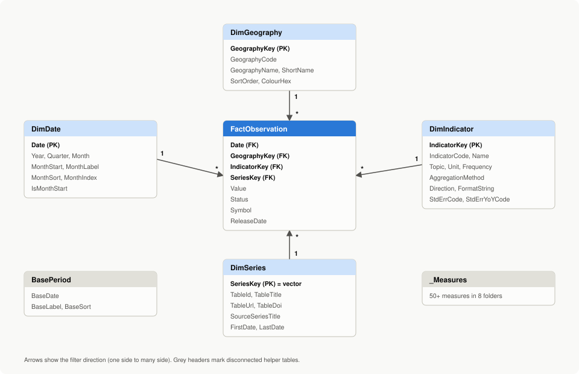

# Semantic model

A star schema with one fact table at monthly (and, for population, annual) grain,
four dimensions and two disconnected helper tables. It is small (about 7,300 fact
rows) and uses Import mode.

The model is built from the files in this folder and also generated, with every
setting below, as TMDL in `project/StJohnsEconomy.SemanticModel` (see
[VALIDATION.md](VALIDATION.md) for how it was checked).

## Tables

| Table | Role | Source (queries.pq) | Key | Rows (snapshot of 2026-10-18) |
|---|---|---|---|---|
| FactObservation | Fact: one value per date, geography and indicator | FactObservation.csv | Date + GeographyKey + IndicatorKey | 7,264 |
| DimDate | Daily calendar, full years 2016 to 2026 | DimDate.csv | Date | 4,018 |
| DimGeography | St. John's (CMA), Canada, Newfoundland and Labrador | DimGeography.csv | GeographyKey | 3 |
| DimIndicator | What is measured, its unit, format and behaviour | DimIndicator.csv | IndicatorKey | 22 |
| DimSeries | Lineage: one row per Statistics Canada vector | DimSeries.csv | SeriesKey (the vector ID) | 61 |
| BasePeriod | Disconnected list of months for the index base | built from DimDate | BaseDate | 129 |
| _Measures | Empty home table for all measures | built in M | none | 0 |

Column definitions are in [docs/data-dictionary.md](../docs/data-dictionary.md).

## Relationships

All relationships are many-to-one from the fact table, single cross-filter
direction (dimension filters fact), and active.

| From (many side) | To (one side) | Cardinality | Cross-filter |
|---|---|---|---|
| FactObservation[Date] | DimDate[Date] | Many to one | Single |
| FactObservation[GeographyKey] | DimGeography[GeographyKey] | Many to one | Single |
| FactObservation[IndicatorKey] | DimIndicator[IndicatorKey] | Many to one | Single |
| FactObservation[SeriesKey] | DimSeries[SeriesKey] | Many to one | Single |

BasePeriod and _Measures have no relationships. BasePeriod is read by the
`[Base Date]` measure through `SELECTEDVALUE`, so a slicer on it never filters the
fact table directly.

Why the date relationship uses a date column: monthly values are keyed to the
first day of the month and annual population estimates to July 1, so a plain
date key keeps the model readable and lets DimDate be marked as the date table.

## Model settings

1. **Mark as date table**: DimDate, date column `Date` (Table tools > Mark as date
   table). The measures use EDATE arithmetic rather than built-in time
   intelligence, but marking the table keeps quick measures and the date
   hierarchy behaving correctly.
2. **Discourage implicit measures**: on (Model view > model properties). Every
   number shown in the report comes from a measure in `measures.dax`.
3. **Hide** in report view: FactObservation[GeographyKey], [IndicatorKey],
   [SeriesKey], [Value]; DimGeography[GeographyKey]; DimIndicator[IndicatorKey];
   DimSeries[SeriesKey]; _Measures[Placeholder].
4. **Sort by column**

   | Column | Sort by |
   |---|---|
   | DimDate[MonthLabel] | DimDate[MonthSort] |
   | DimDate[MonthName] | DimDate[Month] |
   | DimDate[MonthShort] | DimDate[Month] |
   | DimGeography[ShortName] | DimGeography[SortOrder] |
   | DimGeography[GeographyName] | DimGeography[SortOrder] |
   | DimIndicator[ShortName] | DimIndicator[SortOrder] |
   | DimIndicator[IndicatorName] | DimIndicator[SortOrder] |
   | BasePeriod[BaseLabel] | BasePeriod[BaseSort] |

5. **Summarization**: set "Don't summarize" on every numeric attribute column
   (Year, Quarter, Month, MonthSort, MonthIndex, SortOrder, Decimals,
   SourceGeographyVintage, ObservationCount).
6. **Data category**: DimSeries[TableUrl] and DimSeries[TableDoi] as Web URL, so
   the sources table shows working links.
7. **Row-level security**: none. All data is public.

## Geography colours

Colour follows the geography, never its rank, so a filter that removes a series
does not repaint the others. In every line chart set the series colours
explicitly (Format > Lines > Colours); for bar charts without a legend use
conditional formatting with the field value `[Geography Colour]`.

| Geography | Colour | Contrast on #fcfcfb | Secondary encoding |
|---|---|---|---|
| St. John's | #2a78d6 | 4.30:1 | series label, legend |
| Canada | #eb6834 | 3.12:1 | series label, legend |
| N.L. | #1baf7a | 2.74:1 (below 3:1) | series label and legend required; "Show as a table" available |

The three colours are the first three slots of the theme palette. They pass the
colour-vision-deficiency and normal-vision separation checks for all pairs in
light mode (worst pair 9.2 and 24.0 OKLab units).

## Measures

All measures live in `_Measures` and are defined in [measures.dax](measures.dax).
Formats marked F1, F2 or F3 are dynamic format strings; the expressions are at the
top of `measures.dax`.

| Display folder | Measure | Format | Purpose |
|---|---|---|---|
| 1 Core | Value | F1 | Aggregation-aware value (average for stocks and rates, sum for flows); blank unless one indicator and one geography are in context |
| 1 Core | Latest Date | mmm yyyy | Latest period with data in the current filter context |
| 1 Core | Latest Value | F1 | Value at the latest period |
| 1 Core | Latest Period Label | Text | "August 2026", or "July 1, 2025" for population |
| 2 Change | Previous Period Date | mmm yyyy | One month (or one year for annual data) before the latest period |
| 2 Change | Previous Period Value | F1 | Value at the previous period |
| 2 Change | Change vs Previous Period | F2 | Latest minus previous period |
| 2 Change | % Change vs Previous Period | +0.0%;-0.0%;0.0% | Relative change vs previous period |
| 2 Change | Year Ago Date | mmm yyyy | Same period a year earlier |
| 2 Change | Value Year Ago | F1 | Value a year earlier |
| 2 Change | YoY Change | F2 | Change from a year earlier, in the indicator's unit |
| 2 Change | YoY % | +0.0%;-0.0%;0.0% | Year-over-year per cent change (CPI: 12-month inflation) |
| 2 Change | YoY Headline Change | F3 | Points for rates, per cent for everything else |
| 3 Rolling 12 months | 12-Month Rolling Average | F1 | Average of the last 12 monthly values |
| 3 Rolling 12 months | 12-Month Rolling Total | #,0 | Sum of the last 12 months, for flows (dwelling units) |
| 3 Rolling 12 months | 12-Month Rolling Total Year Ago | #,0 | Same window a year earlier |
| 3 Rolling 12 months | 12-Month Rolling Total YoY % | +0.0%;-0.0%;0.0% | Last 12 months vs the 12 months before |
| 4 Index to base period | Base Date | mmm yyyy | Month chosen in the BasePeriod slicer (default January 2018) |
| 4 Index to base period | Base Value | F1 | Value in the base period |
| 4 Index to base period | Index (Base = 100) | 0.0 | Series rebased to 100 in the base period |
| 4 Index to base period | Change Since Base % | +0.0%;-0.0%;0.0% | Cumulative change since the base period |
| 5 Comparison with Canada | Canada Value | F1 | Canada's value for the same indicator and period |
| 5 Comparison with Canada | Gap vs Canada | F2 | Level gap (meaningful for rates) |
| 5 Comparison with Canada | Canada YoY % | +0.0%;-0.0%;0.0% | Canada's year-over-year change |
| 5 Comparison with Canada | YoY Gap vs Canada (pts) | +0.0" pts";-0.0" pts";0.0" pts" | Gap between 12-month changes (CPI: inflation gap) |
| 5 Comparison with Canada | Canada Index (Base = 100) | 0.0 | Canada rebased to the same base period |
| 5 Comparison with Canada | Index Gap vs Canada | +0.0;-0.0;0.0 | Gap in index points since the base period |
| 6 Survey precision | Standard Error | F1 | Published standard error of the estimate (Labour Force Survey) |
| 6 Survey precision | Upper 95% Bound | F1 | Estimate plus 1.96 standard errors (error bars) |
| 6 Survey precision | Lower 95% Bound | F1 | Estimate minus 1.96 standard errors |
| 6 Survey precision | YoY Standard Error | F1 | Published standard error of the 12-month change |
| 6 Survey precision | YoY Change Is Significant | 0 | 1 if the 12-month change exceeds 1.96 standard errors |
| 6 Survey precision | YoY Significance Label | Text | Plain-language significance statement |
| 7 Housing | Multi-unit Share % | 0.0% | Share of permitted dwelling units in multiple-dwelling buildings |
| 7 Housing | Units Permitted per 1,000 Residents | 0.0 | 12-month dwelling units per 1,000 residents (latest July 1 population on or before the latest permit month) |
| 7 Housing | Units per 1,000 vs Canada Label | Text | "0.7 below Canada (7.2)" |
| 7 Housing | Units per 1,000 vs Canada Colour | Text | Hex colour for conditional formatting of that label |
| 8 Display | YoY Period Label | Text | "12-month change, August 2026" (card subtitle) |
| 8 Display | Change Direction Icon | Text | ▲, ▼ or ■ for the headline change |
| 8 Display | YoY Assessment | Text | Favourable, Unfavourable, Neutral or Not significant |
| 8 Display | YoY Delta Label | Text | Icon, change, comparison period and assessment in words |
| 8 Display | YoY Delta Colour | Text | Hex colour for conditional formatting of the delta |
| 8 Display | Gap vs Canada (Display) | +0.0" pts";-0.0" pts";0.0" pts" | Rate gap or 12-month-change gap, in points |
| 8 Display | Gap Assessment | Text | Favourable, Unfavourable or Neutral |
| 8 Display | Gap vs Canada Label | Text | "1.3 pts above Canada (12-month change)" |
| 8 Display | Gap Colour | Text | Hex colour for conditional formatting of the gap |
| 8 Display | Rolling 12-Month Assessment | Text | Favourable, Unfavourable or Neutral for the rolling 12-month change |
| 8 Display | Rolling 12-Month Delta Label | Text | "▲ +22.2% vs previous 12 months (favourable)" |
| 8 Display | Rolling 12-Month Delta Colour | Text | Hex colour for conditional formatting of that label |
| 8 Display | Geography Colour | Text | Fixed colour of the geography in context |
| 8 Display | Index Chart Title | Text | Dynamic title naming the indicator and base period |
| 8 Display | Source Note | Text | Statistics Canada Open Licence notice with table numbers and latest period |
| 8 Display | Caution Note | Text | Shown when values flagged E (use with caution) are in view |

## Checking the measures

The `EVALUATE` query at the end of `measures.dax` returns one row per published
estimate series. [check-query-expected.csv](check-query-expected.csv) holds the
values the same logic produces in Python from the committed CSVs
(`python -m stjohns_econ insights`). After loading the model, run the query in
DAX query view and compare: the rows should match to the displayed precision.

## Theme

[theme.json](theme.json) is a Power BI report theme (View > Themes > Browse for
themes). It validates against Microsoft's report theme schema version 2.159 and
uses the colour tokens documented in [docs/report-spec.md](../docs/report-spec.md):
text in ink colours rather than series colours, solid hairline gridlines, 2 px
lines, a 2 px surface-coloured gap between stacked segments, series labels at the
line ends, and visual titles marked as headings for screen readers.
